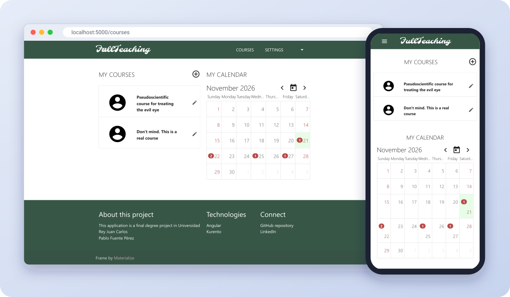

# giise2ebench-st-fullteaching

[](https://github.com/augustocristian/giise2ebench-st-fullteaching/actions/workflows/ci.yml?query=branch%3Amain)
[](https://sonarcloud.io/summary/new_code?id=my%3Aretorch-st-fullteaching)

<p align="center"></p>

FullTeaching is a web teaching platform (courses, forum, files, attenders and live video sessions with chat and
intervention turns, built on OpenVidu). This repository is its test benchmark: the same end-to-end scenarios, written
with four tools and run against the same system. The application and the Selenium suite come from
[retorch-st-fullteaching](https://github.com/giis-uniovi/retorch-st-fullteaching) and are fetched on demand.

## Structure

| Folder | Contents |
|---|---|
| [`sut/`](sut) | The FullTeaching application (Spring Boot backend + Angular frontend, MySQL and OpenVidu). **Fetched, git-ignored** |
| [`selenium-java/`](selenium-java) | E2E suite with Java + JUnit 5 + Selenium, plus the RETORCH configuration. **Fetched, git-ignored** |
| [`cypress-js/`](cypress-js) | The same suite with JavaScript + Cypress |
| [`playwright-csharp/`](playwright-csharp) | The same suite with C# + NUnit + Playwright |
| [`puppeteer-python/`](puppeteer-python) | The same suite with Python + pytest + Puppeteer (through a Node bridge) |
| [`docs/`](docs) | The 16 functional requirements of FullTeaching, in [English](docs/userrequirements_en.txt) and [Spanish](docs/userrequirements_es.txt) |
| [`.github/`](.github) | CI workflow, the composite action that starts the SUT, the test-summary script and Dependabot |

At the root: [`setup-sut.sh`](setup-sut.sh) / [`setup-sut.ps1`](setup-sut.ps1) fetch the two git-ignored folders,
[`deploy.sh`](deploy.sh) / [`deploy.ps1`](deploy.ps1) start the RETORCH stack, and
[`docker-compose.sut-openvidu.yml`](docker-compose.sut-openvidu.yml) is the override used to run the SUT's own compose
(see [Deployment](#deployment)).

All suites cover the same scenarios (user, links, forum, courses, REST operations, e-chat and video sessions). The
Cypress, Playwright and Puppeteer suites are ports of the Selenium one and keep its split into `common`, `utils` and one
test per Java test class; each README maps the Java classes to its own. Where a tool cannot do something, the suite says
so: for example, Cypress cannot drive several logged-in users at once, so its chat and video specs are written but
skipped.

---

## Deployment

**The first step is always the same:** fetch the SUT. `sut/` and `selenium-java/` do not exist after a `git clone`; they
are cloned from upstream by

```bash
./setup-sut.sh          # Windows: .\setup-sut.ps1
```

Run it again at any time to refresh both folders to the latest upstream state (it deletes and replaces them). The script
also points the build context of `selenium-java/docker-compose.yml` at `../sut`, so no copy of `sut/` is needed inside
`selenium-java/`. Requirements: Git and Docker with Compose.

### The stack the suites run against

This is exactly what CI deploys: the compose file shipped with the SUT plus a small override. From the repository root:

```bash
docker compose -f sut/docker-compose.yml -f docker-compose.sut-openvidu.yml -p fullteaching up -d --build
docker compose -f sut/docker-compose.yml -f docker-compose.sut-openvidu.yml -p fullteaching down -v    # stop and delete the data
```

| Service | Image | Port |
|---|---|---|
| FullTeaching (backend + frontend) | built from `sut/Dockerfile` | `5000` (HTTPS, self-signed certificate) |
| OpenVidu server + Kurento | `openvidu/openvidu-dev:2.32.1` | `4443` |
| MySQL | `mysql:8.0` | internal |

The application is ready when `https://localhost:5000` answers (about 45 s after the containers start).

**Why the override.** `sut/docker-compose.yml` starts OpenVidu 2.3.0, but the SUT's own OpenVidu client (2.32.2) calls
`/openvidu/api/...`, which a 2.3.0 server does not serve, so no video session can be created. The override only swaps the
media server for 2.32.1, the same version as the client, and sets the public host to `localhost` so the browser reaches
the published port.

**Test users.** The application seeds its sample data on start. The suites use `teacher@gmail.com` and
`student1@gmail.com` (password `pass`) and the sample courses.

> **Do not restart only the application container on a database that already has data.** The seeding is not guarded, so
> the users are inserted twice and every login fails with a 500 (`NonUniqueResultException`). To restart, remove the
> data too (`down -v`).

### The RETORCH stack (Selenium)

`deploy.sh` / `deploy.ps1` start the stack defined in `selenium-java/` (`docker-compose.yml` + `docker-compose.local.yml`,
project `local`), the one the upstream RETORCH/Jenkins pipeline uses. Pass `down` / `-Down` to stop it.

```bash
./deploy.sh             # Windows: .\deploy.ps1
./deploy.sh down        # Windows: .\deploy.ps1 -Down
```

It uses older service versions than the stack above (MySQL 5.7.21, OpenVidu 2.23.0). Use the stack above when running
the Cypress, Playwright or Puppeteer suites.

---

## Running the Tests

The suites run against the running stack (see [Deployment](#deployment)). They use no real accounts, but they **share the
seeded users and courses**, so run one suite at a time against the same instance. CI avoids this by giving each suite its
own instance.

All suites read the application URL from `SUT_URL` (default `https://localhost:5000`).

### Selenium + Java

Requirements: JDK 11 and Maven; Chrome.

```bash
cd selenium-java
mvn test -Dtest=FullTeachingEndToEndEChatTests -DTJOB_NAME=local -DSUT_URL=https://localhost:5000
```

Details in `selenium-java/README.md` once fetched.

### Cypress + JavaScript

Requirements: Node.js 22 and Google Chrome.

```bash
cd cypress-js
npm ci
npx cypress run --browser chrome      # everything: 27 tests (3 more are skipped on purpose)
npx cypress open                      # interactive mode
npm run lint
```

JUnit files (one per spec) are written to `cypress-js/results/` when `CI` is set. If Cypress fails to start with
`bad option` from a VS Code terminal, run `unset ELECTRON_RUN_AS_NODE` first (PowerShell:
`Remove-Item Env:ELECTRON_RUN_AS_NODE`). More details in [`cypress-js/README.md`](cypress-js/README.md).

### Playwright + C#

Requirements: .NET SDK 8 and PowerShell 7 (`pwsh`).

```bash
cd playwright-csharp
dotnet build
pwsh bin/Debug/net8.0/playwright.ps1 install --with-deps chromium    # once: downloads the browser
dotnet test --settings .runsettings                                   # everything: 27 tests
HEADED=true dotnet test --settings .runsettings                       # watch the browser
dotnet format --verify-no-changes                                     # style check, also run by CI
```

Results: `dotnet test --logger "trx;LogFileName=results.trx" --results-directory TestResults`. More details in
[`playwright-csharp/README.md`](playwright-csharp/README.md).

### Puppeteer + Python

Requirements: Python 3.12+, Node.js 22.12+ and Google Chrome. Puppeteer runs in a small Node bridge driven by the Python
client; the system Chrome is used, no browser is downloaded.

```bash
cd puppeteer-python
(cd bridge && PUPPETEER_SKIP_DOWNLOAD=true npm ci)
pip install .
python -m pytest -m bridge        # bridge smoke tests (12), no SUT needed
python -m pytest -m e2e           # the 27 tests against the SUT
python -m pytest                  # everything
HEADED=1 python -m pytest         # watch the browser
```

Output: JUnit XML in `results/puppeteer.xml`, coverage in `coverage.xml`, logs in `logs/pytest.log`, and a screenshot plus
the browser console errors of every failed test. The tests that need live camera and microphone (`-m media`) run in their
own Chrome and are re-run once on failure. More details in [`puppeteer-python/README.md`](puppeteer-python/README.md).

### Continuous Integration

The pipeline ([`.github/workflows/ci.yml`](.github/workflows/ci.yml)) runs on every pull request and on pushes to `main`,
so a pull request is built once:

1. **Build, once.** `build-sut` fetches the SUT with `setup-sut.sh`, builds its image with `sut/docker-compose.yml` and
   shares it as an artifact.
2. **Lint, in parallel.** Cypress (ESLint), Playwright C# (build and `dotnet format`) and Puppeteer Python (flake8 and a
   syntax check of the bridge).
3. **System tests, in parallel.** Cypress, Playwright and Puppeteer, each on its own runner with **its own instance** of
   the stack, started by the composite action [`.github/actions/start-sut`](.github/actions/start-sut/action.yml) from
   the shared image (no rebuild).

Each system-test job writes a **test summary** (totals, per-class table and failing tests) to the *Summary* tab of the
run, built by [`.github/scripts/test_summary.py`](.github/scripts/test_summary.py) from the JUnit/TRX reports, and uploads
its reports; the SUT logs are uploaded when a job fails. The Selenium suite is not part of this pipeline: it runs in the
upstream RETORCH pipeline.

[Dependabot](.github/dependabot.yml) updates the dependencies of the Cypress, Playwright and Puppeteer suites (and of the
Puppeteer bridge) weekly.

---

<p align="center">
  <a href="https://giis.uniovi.es/"></a>
</p>
